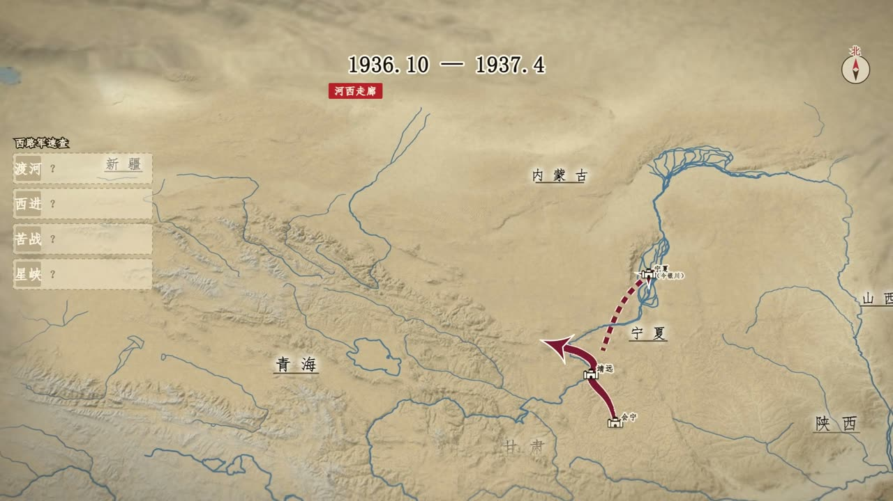
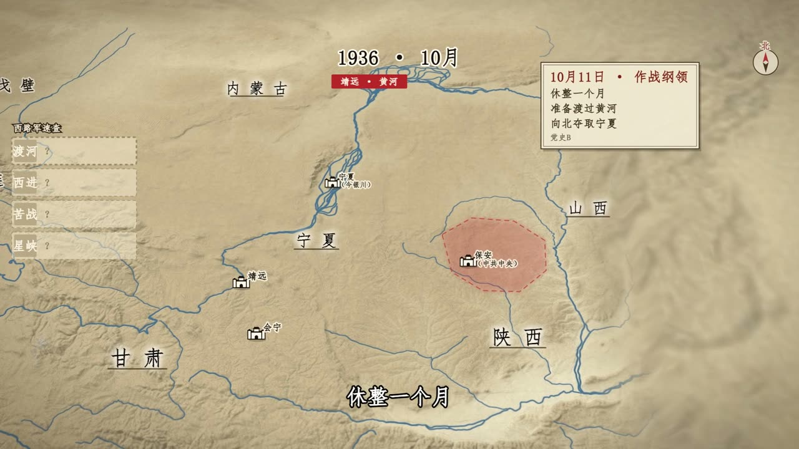
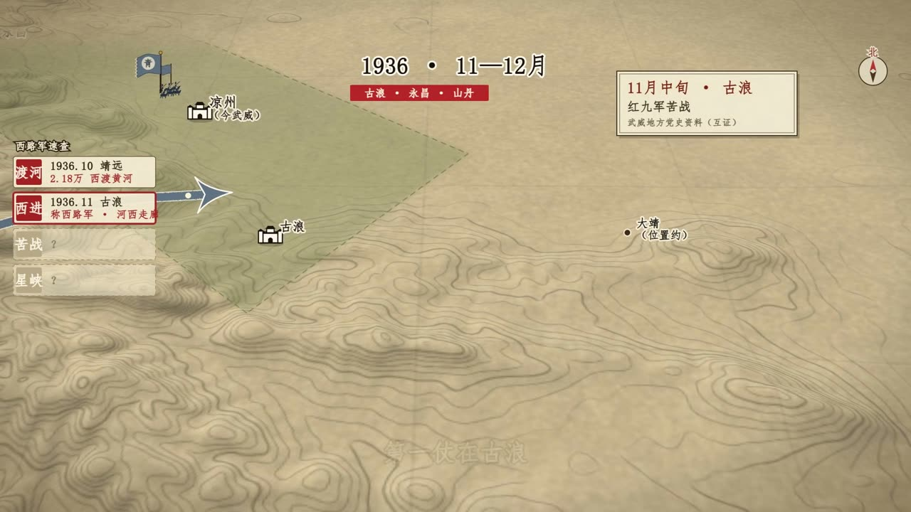
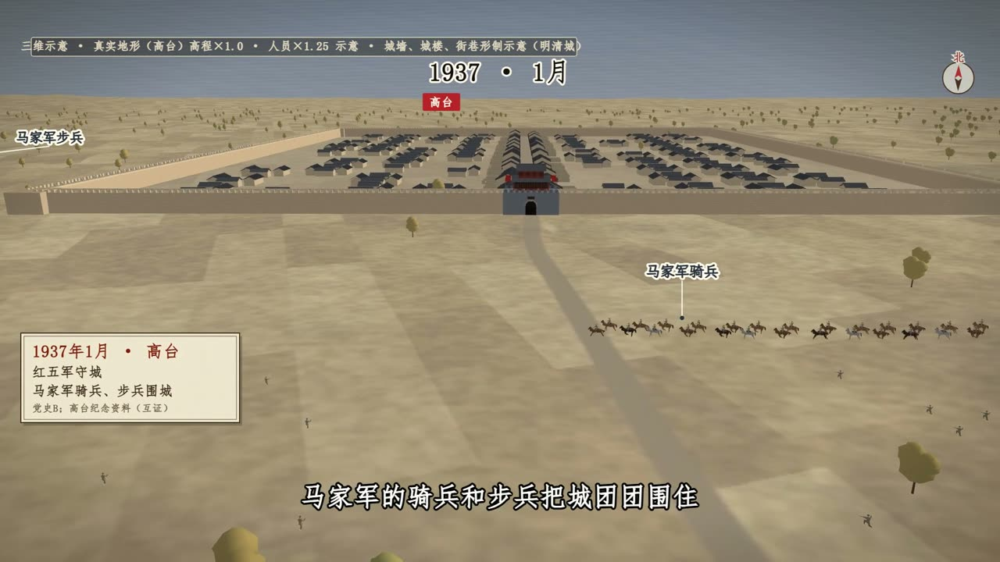
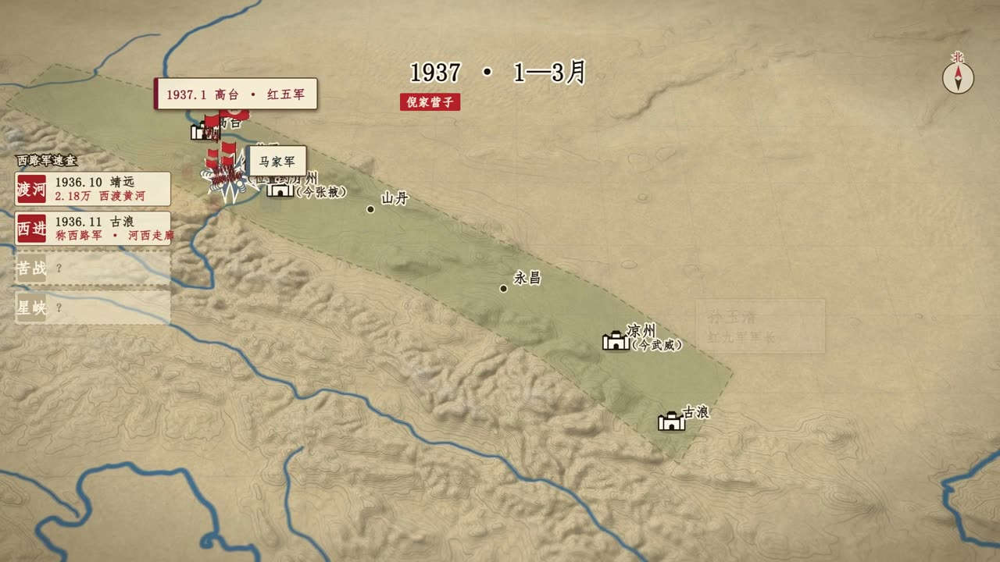
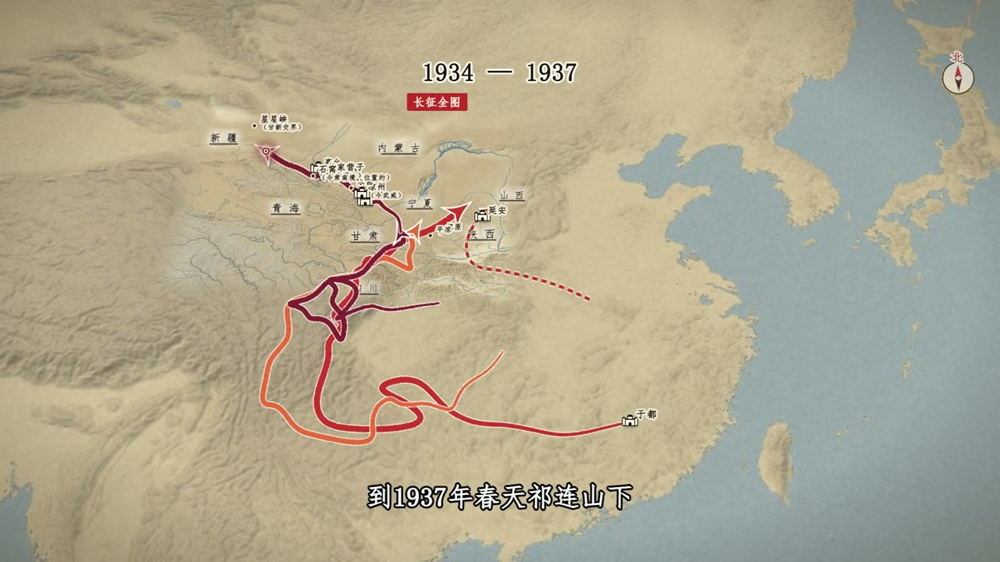

# MapStage

**English** | [中文](README.zh-CN.md)

A narrative map stage for historical videos: one **MapLibre** engine plus one **agent skill**. Antique parchment basemap, routes that march, place names that fade in, cameras that follow the narration, and a `seek(t)` contract so HyperFrames, Remotion or Playwright can capture frame by frame.

## Live site

- **https://hopechen067.github.io/MapStage/** (GitHub Pages)
- **https://mapstage1.pages.dev/** (Cloudflare Pages mirror)

Home, docs, examples and the Studio tuner. Satellite imagery and terrain tiles are fetched at runtime, so you need internet access. Nothing to install.

| Path | What |
|------|------|
| `/` | Home: live map hero with a scrubbable timeline |
| `/docs/` | Docs, rendered straight from `mapstage/references/*.md` (people and agents read the same files) |
| `/examples/` | Example library, filtered by Look / Story / Stage / Play, each with source |
| `/studio/` | Studio: tune the look, copy the preset JSON |

Recent changes: [CHANGELOG.md](CHANGELOG.md).

## What it does

Three layers:

- **Look**: the basemap preset (v3), exported from the Studio tuner. Skins, relief, settlement tiers, optional region isolate.
- **Story**: `story.json` v1. Places, routes, place-name beats, camera, cards, compliance.
- **Stage**: the `seek(t)` time contract, frame capture and QA.

Plus **Play**: `MapStageBoard` gives games and interactive pages the same parchment map. MapStage only draws the map; the rules are yours.

Built-in rules for platform-safe output: no provincial or national border lines, no fog or vignette, Taiwan, Hainan and the South China Sea shown complete. The ten-dash line appears only on full-China shots. See `mapstage/references/compliance.md`.

Not in scope: interactive web-map products, a marketplace, navigation or surveying.

### Demo video

Example output of this stack in a real map-story episode (**Long March ep.14, 西路军**). Low-res clip:

https://hopechen067.github.io/MapStage/media/long-march-ep14-demo.mp4

<video
  controls
  playsinline
  preload="metadata"
  width="720"
  poster="mapstage/site/media/long-march-ep14-poster.jpg"
  src="https://hopechen067.github.io/MapStage/media/long-march-ep14-demo.mp4">
</video>

Longer clip (~36s): [showcases/long-march-ep14/ep14-map-clip.mp4](showcases/long-march-ep14/ep14-map-clip.mp4)

## Showcases

Still frames from the same episode.

<table>
  <tr>
    <td align="center" width="50%">
      
      <br /><sub>Route + timeline card</sub>
    </td>
    <td align="center" width="50%">
      
      <br /><sub>Yellow River · date card</sub>
    </td>
  </tr>
  <tr>
    <td align="center" width="50%">
      
      <br /><sub>Terrain · route arrow</sub>
    </td>
    <td align="center" width="50%">
      
      <br /><sub>3D walled city (Gaotai)</sub>
    </td>
  </tr>
  <tr>
    <td align="center" width="50%">
      
      <br /><sub>Campaign area · tiered labels</sub>
    </td>
    <td align="center" width="50%">
      
      <br /><sub>Whole route</sub>
    </td>
  </tr>
</table>

More files: [showcases/long-march-ep14/](showcases/long-march-ep14/)

| Item | Value |
|------|--------|
| Skill folder | `mapstage` |
| Runtime | [MapLibre GL JS](https://maplibre.org/) 5.6.0, no bundler, no npm runtime dependency |
| Default basemap | **EOX Sentinel-2 cloudless** (public demo WMTS; check provider terms) |
| Terrain / hillshade | Terrarium-encoded DEM tiles (runtime fetch; `encoding: 'terrarium'`) |
| Water / roads | OpenFreeMap vector tiles (OpenMapTiles); no data file in the repo, see [DATA-PROVENANCE.md](DATA-PROVENANCE.md) |
| Region isolate | Optional parchment mask (`ui.showRegionIsolate`). The China outline comes from Natural Earth 10m (public domain); provincial / city shapes are simplified OSM polygons (ODbL). Narrative silhouettes, not official borders |
| License | [MIT](LICENSE) for code and docs; showcase media and third-party terms in [LICENSE-EXCEPTIONS.md](LICENSE-EXCEPTIONS.md) / [NOTICE.md](NOTICE.md) |

## Install as an agent skill

The skill lives in `mapstage/`. Copy that folder into your agent skills directory and reload skills.

```bash
git clone https://github.com/hopechen067/MapStage.git
cp -R MapStage/mapstage ~/.grok/skills/mapstage
# or: ~/.claude/skills/mapstage, ~/.codex/skills/mapstage
```

On Windows (PowerShell):

```powershell
git clone https://github.com/hopechen067/MapStage.git
Copy-Item -Recurse -Force .\MapStage\mapstage (Join-Path $env:USERPROFILE ".grok\skills\mapstage")
```

Then tell your agent:

```text
请使用 mapstage skill。
官网与调参台：https://hopechen067.github.io/MapStage/
仓库：https://github.com/hopechen067/MapStage
我会在 Studio 里调好风格后导出 JSON，请按 SKILL.md / references 应用到地图场景。
```

Style workflow: open the [Studio](https://hopechen067.github.io/MapStage/studio/), tune, **Copy JSON**, paste to your agent.

## Run locally

Only needed for offline work or development. Do not open pages as `file://`.

```bash
git clone https://github.com/hopechen067/MapStage.git
cd MapStage
node mapstage/site/serve.mjs      # http://127.0.0.1:8770/  (same layout as the live site)
```

Only the Studio:

```bash
cd mapstage/tuner
python -m http.server 8765        # then open http://127.0.0.1:8765/
```

Static check (Node on `PATH`; expect `verify ok` at the end):

```bash
cd mapstage/tuner
node verify.mjs
```

Build the full static site into `out/_site`:

```bash
node mapstage/site/build.mjs
```

The build refuses to run if data of unconfirmed license is present (see [DATA-PROVENANCE.md](DATA-PROVENANCE.md)).

## Map tiles

Satellite, DEM and vector tiles are **not bundled**; they are fetched at runtime from configured URLs.

1. Read [NOTICE.md](NOTICE.md).
2. Defaults are in `mapstage/tuner/map-tiles.config.js`.
3. Personal endpoints go in `map-tiles.config.local.js` (gitignored); see `map-tiles.config.example.js`.

EOX public tiles are typically non-commercial and need attribution. This project does **not** grant rights to any commercial map vendor.

## Attribution & compliance

- Follow each basemap / DEM / CDN provider's terms for your use case.
- **Data:** the China outline is Natural Earth (public domain); OSM-derived shapes are ODbL. No separate hydrography pack is shipped. See [DATA-PROVENANCE.md](DATA-PROVENANCE.md) and [LICENSE-EXCEPTIONS.md](LICENSE-EXCEPTIONS.md).
- **Maps shown to the public** may need a review number (审图号) depending on platform and use; judge this for your own release.
- **MapLibre / Three.js:** keep their licenses when redistributing builds.
- **Showcase images and video:** All Rights Reserved demo media unless noted otherwise ([LICENSE-EXCEPTIONS.md](LICENSE-EXCEPTIONS.md)).
