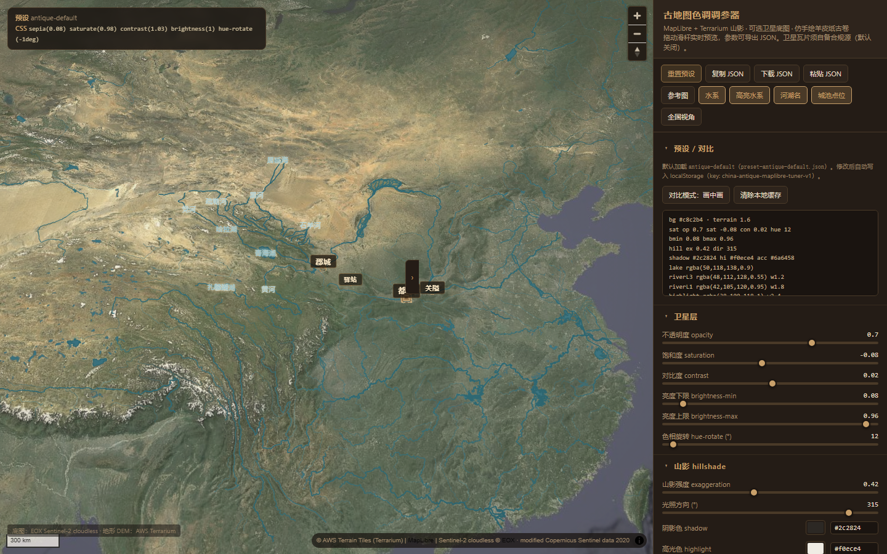
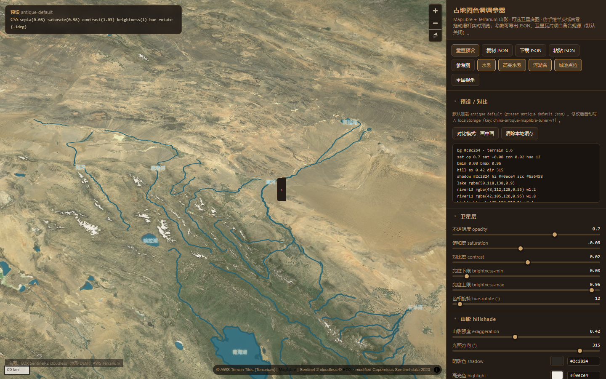

# MapStage

[English](README.md) | **中文**

历史视频的叙事地图舞台：一个 **MapLibre** 引擎加一个 **agent skill**。古卷羊皮纸底图、行进的路线、淡入的地名、跟着口播走的镜头，以及 `seek(t)` 时间契约，HyperFrames、Remotion 或 Playwright 都能逐帧截取。

## 在线官网

- **https://hopechen067.github.io/MapStage/**（GitHub Pages）
- **https://mapstage1.pages.dev/**（Cloudflare Pages 镜像）

首页、文档、示例和调参台 Studio。卫星底图和地形瓦片在运行时拉取，需要联网，无需安装。

| 路径 | 内容 |
|------|------|
| `/` | 首页：可拖时间轴的活地图 |
| `/docs/` | 文档，直接渲染 `mapstage/references/*.md`（人和 agent 读同一份） |
| `/examples/` | 示例库，按 Look / Story / Stage / Play 筛选，每个示例带源码 |
| `/studio/` | Studio：调底图风格，复制 preset JSON |

## 它做什么

三层：

- **Look 底图**：preset v3，由 Studio 调参台导出。皮肤、地形、聚落分级、可选的局部拆出。
- **Story 叙事**：`story.json` v1。地点、路线、地名节拍、镜头、字卡、合规。
- **Stage 舞台**：`seek(t)` 时间契约、截帧与 QA。

另有 **Play**：`MapStageBoard` 给做游戏、做互动页的人提供同一张古卷地图。MapStage 只管地图，规则由你自己写。

内置平台合规规则：不画省界国界、无雾无暗角、台湾海南南海完整。十段线只在全国镜头里出现。详见 `mapstage/references/compliance.md`。

不做：交互式 Web 地图产品、付费货架、导航与测绘。

### 演示视频

本栈在真实地图叙事片中的效果示例（**河西走廊 · 河西四郡**），低分辨率短片：

https://hopechen067.github.io/MapStage/studio/media/hexi-ep07-demo-480p.mp4

<video
  controls
  playsinline
  preload="metadata"
  width="720"
  src="https://hopechen067.github.io/MapStage/studio/media/hexi-ep07-demo-480p.mp4">
</video>

更长片段（约 36 秒）：[showcases/hexi-ep07/hexi-ep07-map-clip.mp4](showcases/hexi-ep07/hexi-ep07-map-clip.mp4)

## 效果展示

同一演示的静帧，以及 Studio 截图。

<table>
  <tr>
    <td align="center" width="50%">
      
      <br /><sub>武威 · 绿洲 / 石羊河</sub>
    </td>
    <td align="center" width="50%">
      
      <br /><sub>酒泉 · 地形 + 水系</sub>
    </td>
  </tr>
  <tr>
    <td align="center" width="50%">
      
      <br /><sub>河西走廊地图镜头</sub>
    </td>
    <td align="center" width="50%">
      
      <br /><sub>聚落特写</sub>
    </td>
  </tr>
  <tr>
    <td align="center" width="50%">
      
      <br /><sub>Studio · 全国视图（EOX）</sub>
    </td>
    <td align="center" width="50%">
      
      <br /><sub>Studio · 河西 / 山影</sub>
    </td>
  </tr>
</table>

更多文件：[showcases/hexi-ep07/](showcases/hexi-ep07/)

| 项 | 内容 |
|------|--------|
| Skill 目录 | `mapstage` |
| 运行时 | [MapLibre GL JS](https://maplibre.org/) 5.6.0，无打包器，无 npm 运行时依赖 |
| 默认底图 | **EOX Sentinel-2 cloudless**（公开演示 WMTS；请自行核对服务方条款） |
| 地形 / 山影 | Terrarium 编码的 DEM 瓦片（运行时拉取，`encoding: 'terrarium'`） |
| 水系 / 道路 | OpenFreeMap 矢量瓦片（OpenMapTiles）；仓库内没有数据文件，见 [DATA-PROVENANCE.md](DATA-PROVENANCE.md) |
| 局部拆出 | 可选羊皮纸蒙版（`ui.showRegionIsolate`）。中国轮廓取自 Natural Earth 10m（公共领域）；省 / 市轮廓是简化的 OSM 多边形（ODbL）。都是叙事轮廓，不是官方边界 |
| 许可 | 代码与文档 [MIT](LICENSE)；演示素材与第三方条款见 [LICENSE-EXCEPTIONS.md](LICENSE-EXCEPTIONS.md) / [NOTICE.md](NOTICE.md) |

## 装成 agent skill

Skill 在 `mapstage/` 目录。把它复制到你的 agent skills 目录，然后重新加载 skills。

```bash
git clone https://github.com/hopechen067/MapStage.git
cp -R MapStage/mapstage ~/.grok/skills/mapstage
# 或：~/.claude/skills/mapstage、~/.codex/skills/mapstage
```

Windows（PowerShell）：

```powershell
git clone https://github.com/hopechen067/MapStage.git
Copy-Item -Recurse -Force .\MapStage\mapstage (Join-Path $env:USERPROFILE ".grok\skills\mapstage")
```

然后对你的 agent 说：

```text
请使用 mapstage skill。
官网与调参台：https://hopechen067.github.io/MapStage/
仓库：https://github.com/hopechen067/MapStage
我会在 Studio 里调好风格后导出 JSON，请按 SKILL.md / references 应用到地图场景。
```

调风格的流程：打开 [Studio](https://hopechen067.github.io/MapStage/studio/) → 调参 → **Copy JSON** → 粘给 agent。

## 本地运行

只在离线或开发时需要。不要用 `file://` 直接打开页面。

```bash
git clone https://github.com/hopechen067/MapStage.git
cd MapStage
node mapstage/site/serve.mjs      # http://127.0.0.1:8770/（布局与线上官网一致）
```

只跑 Studio：

```bash
cd mapstage/tuner
python -m http.server 8765        # 然后打开 http://127.0.0.1:8765/
```

静态校验（需要 Node；末尾应为 `verify ok`）：

```bash
cd mapstage/tuner
node verify.mjs
```

把整个静态官网构建到 `out/_site`：

```bash
node mapstage/site/build.mjs
```

存在许可未确认的数据时，构建会拒绝运行（见 [DATA-PROVENANCE.md](DATA-PROVENANCE.md)）。

## 地图瓦片

卫星、DEM 和矢量瓦片**不随仓库分发**，运行时从配置的 URL 拉取。

1. 先读 [NOTICE.md](NOTICE.md)。
2. 默认配置在 `mapstage/tuner/map-tiles.config.js`。
3. 个人端点写进 `map-tiles.config.local.js`（已 gitignore），参考 `map-tiles.config.example.js`。

EOX 公开瓦片一般仅限非商业并需署名。本项目**不**授予任何商业地图服务商的权利。

## 署名与合规

- 请按你的用途遵守各底图 / DEM / CDN 服务方的条款。
- **数据**：中国轮廓取自 Natural Earth（公共领域）；OSM 来源的轮廓为 ODbL。仓库不含单独的水系数据包。见 [DATA-PROVENANCE.md](DATA-PROVENANCE.md) 与 [LICENSE-EXCEPTIONS.md](LICENSE-EXCEPTIONS.md)。
- **向社会公开的地图**，视平台和用途可能需要审图号，请按你自己的发布方式判断。
- **MapLibre / Three.js**：再分发构建时请保留它们的许可。
- **演示图片与视频**：除另有说明外保留所有权利（见 [LICENSE-EXCEPTIONS.md](LICENSE-EXCEPTIONS.md)）。
